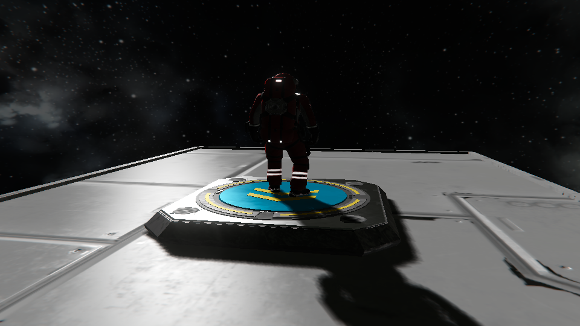

# Player teleporter verification

Tested on 20 November 2026 with Space Engineers 1.211.017 on Linux. The offline world loaded the checkout as a named local mod. A disposable Magnetar dedicated server loaded it through the implicit companion entry point, `3750200326.sbm_MagnetarMod`, using a locally staged copy. One Steam client exercised the dedicated server. A second run used two independent game clients connected over loopback direct transport and a server-local listener for the completion event.



## Placement and countdown

The native cube builder placed two large-grid pads 22.5 m apart, one facing −Z and the other +X. The earlier placement run verified the model, icon, solid deck, unlinked pad ID and obstruction by a large armor block above the destination. The current interaction was exercised in the two-client dedicated world with the same pads and artificial gravity.

The traveler walked onto the source with the jetpack off. The HUD counted down from “Teleport in 10 s. Step off to cancel.” Pressing F during boarding left the traveler on the source. Stepping off at seven seconds remaining cancelled the trip. Re-entering started a fresh ten-second countdown and the traveler departed automatically at zero.

| Dedicated-server check | Observed result |
| --- | --- |
| Stay on source for ten seconds | Both clients saw the engineer arrive at the rotated destination. The server listener received one completion. |
| Stay on destination for longer than ten seconds | The engineer stayed on the destination. The listener count held at one. |
| Step off and board the rotated destination | A fresh countdown returned the engineer to the source. Both clients observed the return and the listener received a second completion. |
| Occupy the destination during the last three seconds | Departure reported an obstruction. Vacating the destination and waiting another ten seconds left the traveler on the source. |
| Make the destination private during boarding | Departure reported that the destination was unavailable or access was denied. |
| Force the client process to exit with eight seconds remaining | The transport continued to list the traveler until its 30-second timeout. The server received no departure reply and the listener count stayed at two through shutdown. |

The offline host also loaded the updated local mod, displayed the countdown and arrived on the linked pad at (172.500, 99.051, 205.000).

In multiplayer, the outbound HUD displayed ten seconds at 10:57:24.836 UTC and confirmed arrival at 10:57:34.936 UTC. The two clients measured the same settled character position to the millimetre on both trips. The independent server listener recorded these two events, in server local time.

```text
2026-11-20 11:57:34.921 - Thread:   1 ->  PadLab observer received 90011001 144115188075855919 141787265624111434 115692577277107903
2026-11-20 11:57:58.087 - Thread:   1 ->  PadLab observer received 90011001 144115188075855919 115692577277107903 141787265624111434
```

## Asset and build checks

The editable pad was inspected in Blender from the approach, standing and exit positions. The export used Blender 5.2.1, SEUT 1.2.2-alpha.3 with asset library 1.7.3, Havok Content Tools 2013.1.0 and MWMBuilder 0.3.3. Havok reported zero errors and warnings. Reading each delivered MWM with the native model importer gave these results.

| Runtime model | Triangles | Vertices | SHA-256 |
| --- | ---: | ---: | --- |
| Finished pad | 1,876 | 3,224 | `b68255690c9c038d5c393a7fbdc45609abc1d2ca9ed482567772a599b9d42c93` |
| Construction stage | 96 | 184 | `c92e11a3b295a0b96fa5e855ae2bfca1e75491e960b6dd94abdd490034150d36` |

Extracting collision from each MWM returned the same 15,945 bytes as the supplied HKT, SHA-256 `d1173a9ea8893d2fc80ee72bca9dad8c33d5f8d6476447692ccd1f637904e29f`. The two delivered MWMs match the copies loaded in the multiplayer run byte for byte. Re-exporting the saved Blender source reproduced both model payloads apart from the embedded FBX source hash.

The direct Release build of `MagnetarMod/MagnetarMod.csproj` passed with zero warnings and errors. The travel tests covered a single world. Cross-node transport and durable lobby-state changes require a cluster implementation and a separate end-to-end test.
